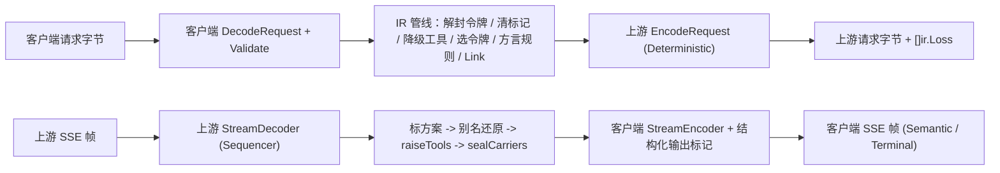

# 协议转换与中间表示

本文记录 `protocol/ir`、`protocol/sse`、`protocol/codec/*` 与 `protocol/convert` 的转换架构、中间表示不变量、扩展约束、连续性信封和工具适配规则。分组准入与路线表见[统一协议能力](../interfaces/protocol_capabilities.md)。

线上流量统一通过 `protocol/convert` 与 `protocol/codec/*` 执行跨协议转换、Messages 与 Responses 原生重放解封，以及同协议 Responses 客户端工具轻量适配（转发执行与流控边界见[转发与流式输出](gateway_request_lifecycle.md#protocol_conversion_boundary)）。覆盖范围包括 OpenAI 兼容平台、Anthropic 平台（含 Vertex 与 Bedrock）、Gemini 平台（含 AI Studio、Code Assist OAuth、Vertex 与 OpenCode Gemini）、Antigravity 平台和 Qoder 平台。

## 章节导航

- [中间表示与不变量](#ir_model)：核对消息结构、用量分桶或流事件顺序时读取。
- [扩展机制与防滥用规则](#extension_mechanisms)：处理协议特有条目、未知字段或普查快照时读取。
- [信息丢失上报](#loss_accounting)：增改编码器取舍规则或语义摘要校验时读取。
- [上游方言能力](#dialect_capabilities)：按端点能力裁剪工具、推理预算或采样参数时读取。
- [转换引擎与管线](#conversion_pipeline)：跟进请求与流式转换步骤或输出标记时读取。
- [推理连续性](#reasoning_continuity)：维护 `trc1:` 信封、`CallMemory` 或原生路径重放时读取。
- [工具身份降级与还原](#tool_adaptation)：修改跨协议或同协议客户端工具适配时读取。
- [网关接线形态](#gateway_integration)：核对各上游协议族的合并入口、流控不变量或原生重放边界时读取。
- [新增协议步骤](#adding_a_protocol)：接入新协议编解码器与测试套件时读取。

## 中间表示与不变量

`protocol/ir` 采用「消息加有序 `Part`」的单一规范结构，独立于任何单一供应商的线格式。单协议编解码器覆盖 `openai_chat_completions`、`anthropic_messages`、`openai_responses` 和 `gemini_generate_content`，另有仅实现上游侧请求编码与流解码的 `qoder_chat`。

Responses 的平铺条目在解码时按角色归并成消息，Messages 的 `tool_result` 块与 Gemini `user` 轮中的 `functionResponse` 部件拆分为独立的 `tool` 角色消息。

| 核心结构 | 职责与结构约束 |
| --- | --- |
| `Request` | 承载模型、带外 `System`、有序 `Messages`、工具声明、`Namespaces`、采样与推理配置、结构化输出和会话标识 |
| `Message` | 取值 `system`、`developer`、`user`、`assistant`、`tool` 五种角色，保留消息内 `Parts` 原始顺序 |
| `Part` | 按 `Kind` 精确激活一个载荷分支（`text`、`reasoning`、`tool_call`、`tool_result`、`media`、`refusal`、`opaque`），assistant 或响应 `text` 可带 `ReplayToken`，各分支可附 `CacheMark` 与 `Extra` |
| `Response` | 承载响应标识、有序 `Parts`、归一化结束原因 `Finish`、客户端可见 `Usage` 和 `ServiceTier` |
| `Usage` | 保存互不相交的输入桶（新鲜 `Input`、`CacheRead`、`CacheWrite` 及 TTL 分档）和包含 `Reasoning` 的 `Output`，换算口径见[客户端用量与缓存](../interfaces/protocol_capabilities.md#client_usage_cache) |

`ir.Validate` 与 `ir.ValidateResponse` 校验联合分支唯一性：`tool` 消息只含 `tool_result`，`ToolResult.Content` 只含 `text` 与 `media`。`ir.Link` 按时间序将 `ToolResult.Tool` 绑定到同 `CallID` 的前序调用。

流式响应在解码后统一表示为顺序化的 `ir.Event` 序列，`ir.ValidateStream` 强制执行以下七条不变量：

1. 首事件固定为唯一的 `response_start`。
2. 任意时刻最多打开一个 `Part`，块序号 `Index` 从 `0` 起连续递增。
3. `part_delta` 仅在对应 `Part` 打开期间发出，且增量字段与 `Part.Kind` 一致。
4. `part_end` 携带该 `Part` 的完整最终快照（全文、完整参数、推理分段与重放令牌）。
5. `usage` 事件仅出现在 `response_start` 之后，每次均携带按协议规则合并稀疏帧后的完整快照。
6. 全流恰好以一个 `response_end` 或 `error` 收尾，终态前所有已打开 `Part` 均已闭合，终态后无后续事件。
7. 上游异常中断时，`StreamDecoder.Close(cause)` 先闭合未完结 `Part`（工具调用标 `Incomplete: true`），再发出 `error`。

上游并行工具调用发生参数交错时，流解码器通过 `ir.Sequencer` 缓冲非活动槽位事件，在当前 `Part` 闭合后按槽位升序释放。缓冲响应与「上游强制流式、客户端请求非流式」统一经 `ir.Accumulator` 将规范事件流折叠为 `ir.Response` 后编码。

## 扩展机制与防滥用规则

解码器保留线报文中的全部信息，按适用范围将协议特有内容放入三类容器：

| 容器 | 存放内容 | 消费与写出边界 |
| --- | --- | --- |
| 建模字段加方案标记 | 语义相同但取值互不通用的跨轮状态，当前为 `ReplayToken`（签名与加密推理载荷） | `convert` 按目标 `Dialect.ReplayScheme` 与提供商归属决定还原或丢弃 |
| `OpaqueItem` | 仅来源协议可表达的完整条目或托管工具声明（如 `compaction`、`web_search_call`、`server_tool_use`） | 同源编码器原样写回，异源编码器丢弃并记录 `opaque_item_dropped` 或 `hosted_tool_dropped` |
| `Extra` | 已建模 JSON 对象上未声明的额外成员（`Origin` 加 `map[string]jsontext.Value`） | 同源编码器整体写回，异源编码器丢弃并记录 `extra_dropped` |

编解码器在私有线结构体上通过 `encoding/json/v2` 的 `json:",embed"` 自动收集未知成员，保留原始数字字面量与字符编码，`Extra.IsZero` 确保空映射在序列化时省略。

请求解码显式开启 `jsontext.AllowInvalidUTF8(true)` 兼容非 UTF-8 历史字节，同时保持默认重名键拒绝，与网关入口 `wirejson` 校验一致。

为防止无类型扩展退化为隐式耦合通道，仓库通过测试执行三条约束：

1. 源码扫描测试禁止 `protocol/codec`、`protocol/qoder` 与 `protocol/convert` 的生产代码出现 `.Members[` 按键读写，任何需按名读取的字段必须先提升为建模字段。
2. 普查快照测试遍历真实客户端录制语料，将落入 `Extra` 与 `OpaqueItem` 的 JSON 路径写入 `testdata/golden/census/<protocol>.txt`，使新版客户端字段在评审时可见。
3. 新增 IR 建模字段须满足至少两个协议存在等价概念，或某一目标编码器必须读取该字段才能生成合法上游请求。

## 信息丢失上报

解码阶段零丢失，信息取舍只允许发生在 `convert` 的跨协议变换与目标协议编码器中。每次字段丢弃、结构近似、指令移位、块重排、工具配对修复或确定性 ID 改写，都会生成一条带 `LossKind`、IR 路径 `Path` 和可选 `Detail` 的 `ir.Loss`。

请求变换若增删或移动了顶层工具与消息片段，`convert` 会把目标编码器产出的 `Loss.Path` 映射回原始客户端请求坐标。定律测试（Q4 与 S4）将上报的每条 `Loss` 依次作用到源端 `ir.Essence` 语义摘要上，验证变换结果与目标端重解码摘要完全一致，确保不存在未申报的静默丢弃或篡改。

## 上游方言能力

同一线协议在不同上游平台与模型下具有不同的能力边界。编解码器通过纯数据 `ir.Dialect`（在 `convert.Dialect` 重导出）接收目标端点约束，内部禁止按平台名分支：

| 字段组 | 主要字段 | 控制行为 |
| --- | --- | --- |
| 工具能力 | `Tools`、`ToolNameMaxBytes` | 声明原生支持的 `function`、`custom`、`namespace`、`client_search`、`hosted_web_search` 掩码及函数名字节上限 |
| 连续性与推理历史 | `ReplayScheme`、`ProviderID`、`ReasoningHistory`、`PlaceholderToken` | 指定端点签发与接受的令牌方案、账号绑定提供商 ID、明文推理回传范围（`none`、`tool_turns`、`all`）及无签名调用占位符 |
| 推理预算与档位 | `Reasoning`、`StripEffort` | 提供模型支持的思考开关、档位集合、预算上下限与输出余量，并在需要时剥离出站线级 `effort` |
| Schema 与参数过滤 | `SchemaDialect`、`DropTemperature`、`DropTopP`、`DropTopK`、`OmitStopSequences` | 选择 JSON Schema 清洗方言（标准透传、Gemini 大写类型子集、Antigravity 小写七键白名单加描述约束提示）并按模型属性剔除禁用的采样和停止序列参数 |
| 协议附加开关 | `OmitStoreAndInclude`、`AllowBillingHeader`、`StatelessResponses` | 控制跨协议 Responses 默认字段注入、客户端计费头文本保留，以及面向无状态上游的 Responses 来源状态与工具配对门禁 |

## 转换引擎与管线

`protocol/convert` 提供窄字节边界：`NewExchange` 接收客户端请求字节与路由选项，产出上游请求字节、流式转换器 `Stream` 和缓冲聚合器 `Buffer`。`clientCodec` 与 `upstreamCodec` 由 `convert` 定义并在 `registry.go` 显式登记，不使用 `init` 注册。

单次上游尝试的请求管线由 `Exchange.UpstreamRequest` 执行一次并缓存克隆副本：

1. 调用客户端协议 `DecodeRequest`（`/v1/chat/completions` 上无 `messages` 但带顶层 `input` 的 Cursor 请求先提取 Chat 控制项再交 Responses 解码器，响应视图保持 Chat），校验 `ir.Validate` 并快照剥离前的 `RequestInfo`。
2. `openCarriers` 解包历史 `trc1:` 信封，并按客户端调用 ID 从 `CallMemory` 取回上游调用 ID 与调用级令牌。
3. `stripClientMarkers` 在跨协议且 `!Dialect.AllowBillingHeader` 时移除 `x-anthropic-billing-header:` 系统文本并上报 `client_marker_dropped`。
4. `lowerTools` 将目标方言不支持的客户端工具声明与历史调用降级为普通函数，生成可跨轮传递的 `ToolMap`。
5. `selectReplayTokens` 按目标 `ReplayScheme`、`ProviderID` 和 `ReasoningHistory` 筛选重放令牌与明文推理。
6. 应用 `Dialect` 采样、停止词、`StripEffort` 和跨协议默认参数规则（单协议直编不注入跨协议默认值以保持往返不动点；Messages 显式关闭思考转往 Responses 或 Chat 时先经 `Dialect.Reasoning` 校验目标能力，仅在模型明确支持 `"none"` 时输出 `effort="none"`，否则按模型能力回退至 `"minimal"`、纯推理模型最低档位或直接省略）。
7. 执行 `ir.Link` 补齐工具结果归属。
8. 调用上游协议 `EncodeRequest`，开启 `json.Deterministic(true)` 保证键序确定，缺失历史条目 ID 一律由内容 SHA-256 派生，保证相同输入在同版本内逐字节稳定以命中提示缓存。

响应方向上，`Stream.Write` 与 `Stream.Close` 对每个上游帧依次执行五步：

1. 上游 `StreamDecoder` 产出顺序化 `ir.Event`，并为解码出的令牌打上 `Dialect.ReplayScheme` 与 `Dialect.ProviderID`。
2. 按需执行 `MapUpstreamToolName` 将上游工具别名还原为降级后的声明名，再由 `raiseTools` 按请求阶段生成的 `ToolMap` 还原客户端工具种类、命名空间与参数解包。
3. `sealCarriers` 在非 Gemini 客户端上将模型生成的 Base64 图片部件渲染为 `` 可见文本（记 `media_unsupported`），把普通文本附带的重放签名拆入尾随空推理块，将调用级令牌写入 `CallMemory`，并把跨协议推理令牌或无令牌明文推理封装为 `trc1:` 信封（目标无 `ReplayScheme` 或面向 Chat 客户端时丢弃签名并记 `replay_token_dropped`）。
4. 客户端 `StreamEncoder` 编码目标协议 SSE 帧，从保留的原始 `ir.Request` 回显客户端模型、工具声明和 `IncludeUsage` 控制项。
5. `output_meaning.go` 直接依据结构化 `ir.Event` 与编码器状态标注每帧的 `Semantic`（有效内容或调用）和 `Terminal`（正常或异常终态），供外层读取循环控制前导帧暂存窗口与首包计时，无需二次反解析输出 JSON。

## 推理连续性

编解码器本身不感知信封格式，只原样读写 `Token.Data`。方案判定、信封封装与跨轮取舍全部集中在 `ir/token.go`（`FormatCarrier`、`ParseCarrier`）与 `convert/carriers.go`。

信封采用无填充 `base64url` JSON 载荷格式 `trc1:<scheme>:<payload>`，合法 `<scheme>` 限定为 `anthropic`、`antigravity_claude`、`openai`、`xai`、`gemini`、`plain` 六种：

| 载荷键 | 含义与适用方案 |
| --- | --- |
| `d` | 签发方原始令牌文本（除 `plain` 外的五种方案） |
| `t` | 推理原文；用于签名绑定原文的 `anthropic`、`antigravity_claude` 以及无令牌备份方案 `plain` |
| `r` | 布尔标记，标识该块是否来自 `redacted_thinking` |
| `p` | 可选正整数提供商 ID；在账号绑定方案 `openai` 与 `xai` 中标识签发账号 |

Antigravity 的 `claude-*` 模型使用独立的 `antigravity_claude` 方案，与 Anthropic 平台的 `anthropic` 签名互不混用。该路线遇到异源或缺失签名的历史思考块时将其降级为可见文本，并清空当轮 `thinkingConfig`。Antigravity 的 `gemini-*` 模型与标准 Gemini 平台共用 `gemini` 方案，同方案 `trc1:gemini` 信封可在两类上游间跨轮复用。

客户端方向上，`sealCarriers` 按目标客户端协议与令牌种类保存连续性数据：

| 场景 | 客户端方向封装行为 |
| --- | --- |
| Messages 客户端 | 有令牌推理写入 `thinking.signature` 或 `redacted_thinking.data`（普通文本附带签名时追加空 `thinking` 块承载，空文本仅含签名时只输出该空 `thinking` 块），无令牌明文推理封装为 `plain` 信封 |
| Responses 客户端 | 有令牌推理（含普通文本附带签名生成的空 `reasoning` 条目，空文本仅含签名时不产生空 `message` 条目）与无令牌明文推理均封装进 `reasoning.encrypted_content`，支持仅回传密文的续聊轮次恢复文本 |
| Chat 客户端 | 无不透明线字段，丢弃推理与文本签名令牌并记录 `replay_token_dropped`，可见推理照常写入 `reasoning_content` |
| 调用级令牌与上游调用 ID | 三种客户端协议均无逐调用不透明字段，统一经网关注入的 `CallMemory` 按客户端调用 ID 存取 |

上游方向上，`openCarriers` 将无法通过 `ParseCarrier` 校验的客户端令牌一律标为 `unknown`（不做前缀猜测），`selectReplayTokens` 按下表裁决：

| 令牌方案 | 写出条件 | 写出结果 | 条件不满足时的处理 |
| --- | --- | --- | --- |
| 与 `Dialect.ReplayScheme` 相同 | 非账号绑定方案，或信封 `p` 与 `Dialect.ProviderID` 任一为 `0`，或两者相等 | 还原签发方原文 `d`；`anthropic` 与 `antigravity_claude` 同步还原原文 `t` | 丢弃令牌并记 `replay_token_dropped`，文本按 `ReasoningHistory` 处理 |
| `plain` | `Dialect.ReasoningHistory` 允许回传明文推理 | 写出推理文本 `t`（如 Chat `reasoning_content` 或 `passback` 无签名思考块） | 丢弃文本并记 `reasoning_text_dropped` |
| `unknown` | 同协议路线 | 原样写出原始令牌文本 | 丢弃令牌并记 `replay_token_dropped`，文本按 `ReasoningHistory` 处理 |
| 其他异源方案 | 不写出 | 无 | 同上 |

客户端携带跨协议历史在后续轮次落入原生透传路径时，由 `convert.PrepareNativeReplay` 在出站前原地处理请求字节：

1. 先用 `bytes.Contains` 短路，再用流式 `jsontext.Decoder` 仅扫描协议令牌路径（Messages assistant 思考块，以及 Responses HTTP 或 WS `response.create` 的 `reasoning.encrypted_content`）。
2. 协议令牌路径上不存在合法 `trc1:` 信封时，直接原样返回输入切片，正文字面量 `"trc1:"` 与 `session.update` 等其他 WS 帧保持逐字节不变。
3. 方案与账号匹配时，原地还原为签发方裸令牌 `d`（`anthropic` 同步写回 `t`），未改动成员与大整数精度原样保留。
4. 方案或账号不匹配时，按目标原生路径与方言执行下表修复：

| 原生目标路径 | 方案或账号不匹配时的原地处理 |
| --- | --- |
| `passback` Messages | 信封携带文本 `t` 时保留 `thinking` 块并清空 `signature`，无文本时删除该块 |
| 常规 Messages | 删除对应思考块；assistant `content` 变空时填入 `(assistant content removed)` 文本块；若启用了 `thinking` 且当前工具循环末条 assistant 失去前导思考块，将剩余 `thinking` 块降级为文本块并移除顶层 `thinking` |
| Responses HTTP 与 WS | 仍有非空 `summary` 或 `content` 时仅删除 `encrypted_content`（`store: false` 同步移除合成 `id`），无可见内容时删除整条 `reasoning` 条目 |

## 工具身份降级与还原

Responses 客户端支持自由语法 `custom` 工具、`namespace` 作用域工具与客户端发现工具 `tool_search`。面对不支持全集工具的目标方言，`convert` 通过与协议解耦的双向变换完成降级与还原：

| 工具机制 | 请求侧降级（`lowerTools`） | 响应侧还原（`raiseTools`） |
| --- | --- | --- |
| `custom` 工具 | 降为单字符串字段 `{"input": "..."}` JSON Schema 的函数工具，历史调用输入包装为对应 JSON 字符串 | `part_start` 恢复 `ToolCustom` 身份并暂存参数增量，`part_end` 解包出原始 `input` 文本后发出 |
| `tool_search` | 降为固定 Schema 的 `tool_search` 代理函数，并将历史 `tool_search_output` 发现的声明提升入工具列表 | 将 `tool_search` 函数调用还原为 `ToolClientSearch` 调用 |
| `namespace` | 按确定性规则扁平化为单层函数名（默认 `functions` 作用域还原裸名，超长名带哈希后缀截断至上限并做冲突检测） | 按 `ToolMap` 将扁平函数名拆分还原为原命名空间与工具名 |

`ToolMap` 支持序列化并保存降级后的工具声明切片 `LoweredTools`，可通过 `Options.Tools` 跨轮传入，满足 Responses WebSocket 首轮预热后次轮省略 `tools` 字段的续接需求。

同协议 Responses 发往仅支持普通函数的 Responses 上游时，走 `NeedsResponsesToolAdaptation`、`AdaptResponsesTools`、`RestoreResponsesTools` 和 `NewResponsesToolStream` 轻量入口。

该入口复用 `lowerTools` 与 `raiseTools` 规则，只改写工具声明与调用输出条目，其余请求字段、缓存断点、`compaction` 条目、裸推理令牌和托管工具中间流事件原样透传。网关与 WebSocket 的四个同协议接入点共用该入口：

| 同协议接入点 | 请求侧降级与状态登记 | 响应侧还原与协同规则 |
| --- | --- | --- |
| OpenAI API Key HTTP 透传 | 在兼容归一化之后、`PrepareNativeReplay` 解封之前按映射后模型方言调用 `AdaptResponsesTools`，在请求状态保存 `ToolMap` | 流式经 `NewResponsesToolStream` 管道包装，缓冲经 `RestoreResponsesTools` 还原并在展开命名空间后重跑 `CodexToolNameReverse` |
| 兼容 Responses API Key 转发（如 DeepSeek） | 在请求前奏按映射后模型方言降级客户端工具并保存 `ToolMap`，随后剥离非 OpenAI 平台的顶层 `prompt_cache_options` | 流式与缓冲响应按当次请求 `ToolMap` 还原，与原生命名空间还原及 `CodexToolNameReverse` 依次组合 |
| Grok Responses 转发 | 先提升 `additional_tools` 条目再调用 `AdaptResponsesTools`，保留 Grok 模型映射、不支持字段剥离与 `Compact` 摘要回合构造 | 流式在执行器层包装 `NewResponsesToolStream`，缓冲及流事件兜底回调共用幂等的 `RestoreResponsesTools` |
| Responses WebSocket HTTP 桥 | 每轮（含本地直接返回的 `generate: false` 预热轮）在预热完成或真实输出提交后将含 `LoweredTools` 的会话 `ToolMap` 存入连接状态（未输出前切号保留上轮状态），续聊轮省略 `tools` 或 `model` 时自动继承，显式 `tools: []` 时清空 | 按当轮快照 `ToolMap` 包装上游 SSE 流并过滤非错误心跳帧，还原后再写入重放采集器与下游 WS 帧 |

四个接入点遇到客户端工具名称冲突或非法声明时直接返回本地 HTTP 400（WebSocket 关闭码 `1008`），并标记模型能力类本地拒绝以跳过外层切号与提供商健康扣分。

## 网关接线形态

网关按上游协议族合并转换入口与响应读取函数，每个上游协议族只保留原生路径和一条与客户端协议解耦的转换路径：

| 上游协议族 | 请求转换入口与后处理 | 合并响应读取函数 |
| --- | --- | --- |
| Responses（OpenAI 兼容平台） | `openaiforward.RunConvertedResponses`（含 `/v1/chat/completions` 上带顶层 `input` 的 Cursor 请求），编码后执行无损字节级重放守卫、最新轮裁剪、`TodoGuard` 与模型参数修正 | `upstream/openai` 的 `ReadConvertedStreaming`、`ReadConvertedBuffered` |
| Chat（OpenAI 兼容平台） | `openaiforward.RunConvertedRawChat`，直接从 `trc1:plain` 信封恢复推理文本，编码后执行模型属性修正 | `upstream/openai` 的 `ReadRawChatConvertedStreaming`、`ReadRawChatConvertedBuffered` |
| Messages（Anthropic、Vertex、Bedrock 与兼容平台端点） | `forward.AsConverted` 与 `openaiforward.ForwardConvertedAnthropic`，保持 `Mimic -> EnforceCacheControlLimit -> InjectAnthropicCacheControlTTL1h` 顺序并接入 Bedrock 区域路由、SigV4/API Key 签名与二进制 EventStream 转 SSE 桥 | `openaiforward` 的 `ReadConvertedAnthropicStreaming`、`ReadConvertedAnthropicBuffered` |
| Grok Chat 转 Responses | `httpapi` 的 `GrokExecutor.ChatResponses`（`Dialect.OmitStoreAndInclude = true`），按 OAuth 与 API Key 区分免费档伴生工具注入与缓存路由，复用 Responses 合并读取器 | 同第一行 |
| GenerateContent（Gemini 与 OpenCode Gemini） | `googleforward.Gemini.ForwardConverted`（含带 `input` 的 Cursor Chat 单跳），按 `(APIKeyID, ProviderID, mappedModel)` 注入 `CallMemory`，保留 AI Studio 归一化、Code Assist 包装、Vertex 与 OpenCode 头适配。`/v1/messages/count_tokens` 清空 `ReplayScheme` 与 `PlaceholderToken` 后包装为 `countTokens` 请求体 | `upstream/gemini` 的 `ReadConvertedStreaming`、`ReadConvertedBuffered` |
| Antigravity（`v1internal` GenerateContent） | `googleforward.Antigravity.ForwardConverted`（含带 `input` 的 Cursor Chat 单跳），按模型族推导 `SchemaAntigravity` 方言与 `(APIKeyID, ProviderID, mappedModel)` 作用域 `CallMemory`，编码后依次执行身份补丁、`CleanGeminiRequest` 与 `WrapV1InternalRequest` | `upstream/antigravity` 的 `ReadConvertedStreaming`、`ReadConvertedBuffered` |
| Qoder（COSY 网关） | `gateway/provider.QoderRuntime` 与 `upstream/qoder.Executor`（含带 `input` 的 Cursor Chat 请求与旧式 Responses `messages` 入口归一化），解码 `PayloadRequest` 后衔接 `cch=<cch>;` 指纹归一化、会话规划与工具能力门禁 | `upstream/qoder` 的 `ReadConvertedStreaming`、`ReadConvertedBuffered`（先经 `QoderToolNameMapper` 还原上游工具别名再交 `raiseTools`，无令牌明文推理封装为 `trc1:plain` 信封） |

网关流控与原生重放遵循七条跨模块约束：

1. 合并流式读取器在观测到首个 `Semantic == true` 输出帧或不可重试终态之前将非语义前导帧暂存于本地缓冲，使上游在首帧后紧跟可重试错误、空完成或静默拒答时仍可触发外层切号。
2. 流式读取统一经 `NewDeferredOutputContext` 在首个实际输出帧写出时提交响应头。若保活心跳已提前提交 `200 text/event-stream`（`CommittedSSE` 为真），后续超时或上游失败改发无计时的客户端协议终态 SSE 错误帧。
3. Gemini 与 Antigravity 流在观测到 `finishReason` 后立即调用 `c.Complete()` 停止下游保活心跳，继续等待最多 5 秒收集稀疏 `usageMetadata` 尾帧，待上游读取结束后再调用 `Stream.Close(nil)` 发出最终 `usage` 与 `response_end`。
4. 跨 Claude 模型切号遭遇 HTTP 400 签名拒绝，或 Grok 同号遭遇失效 `xai` 密文 400 时，分别按字节流无损剥离历史推理签名或密文并在同提供商上重试一次。
5. Gemini 上游返回签名相关 HTTP 400 时，`ExchangeConverted` 以清空 `ReplayScheme`、不传 `Calls` 且保留 `StripEffort` 与 `PlaceholderToken` 的选项重建兼容请求同号重试一次，原 `Exchange` 保持用于封装新响应令牌与 `CallMemory`。
6. Antigravity 可恢复失败按模型族重试：`claude-*` 依次剥离思考、降级工具文本或修正非 `adaptive` 预算后重编，`gemini-*` 替换占位签名或切往 404 备用模型的 `Exchange`。
7. Messages 原生转发（含 Anthropic、Vertex、Bedrock、兼容平台端点与 `/v1/messages/count_tokens`）和 Responses 原生转发（含 HTTP、`/v1/responses/input_tokens` 预检、专用 WS、连接池 WS 与 WS HTTP 桥）在出站前调用 `PrepareNativeReplay` 解封同方案信封或清理异源信封。

后台连通性探针（`antigravity.BuildClaudeTestRequest` 与 Qoder 测试执行）以及本地或预检计数辅助入口（`PrepareAnthropicInputTokens`、`PrepareNativeInputTokens`、`tokenestimate.Anthropic`、`NormalizeOpenAIResponsesLegacyIngress`）同样直接调用上述编解码与转换管线。

## 新增协议步骤

接入新协议（或仅实现上游侧的专用协议）按以下步骤完成：

1. 在 `backend/internal/protocol/codec/<name>/` 创建纯包（去掉重复包名前缀），在 `wire.go` 定义不导出的私有线结构体并挂载 `json:",embed"` 未知成员映射，不复用外部共享报文结构体。
2. 实现请求、非流式响应、流式编解码文件（仅作上游的协议只实现 `upstreamCodec` 所需方法），流解码器须通过 `ir.ValidateStream` 七条不变量，用量经 `wirejson` 校验后合并为不相交 `ir.Usage`。
3. 在 `protocol/convert/registry.go` 的 `clientCodecs` 或 `upstreamCodecs` 显式表登记适配器，并在 `dialect.go` 补充默认方言能力。
4. 在 `tools/architecture/catalog.go` 的 `leafDependencies` 登记新包依赖（`Production` 包含自身包路径），保持编解码器之间互不导入，并更新[后端模块地图](backend_modules.md#package_map)。
5. 在 `protocol/testkit` 补充不依赖该编解码器的独立严格请求校验器、流语法校验器和客户端模拟器，在 `testdata/wire/<protocol>/` 补齐规范场景夹具。
6. 按[协议转换测试与缺陷回归](../operations/development_workflow.md#protocol_conversion_testing)跑通 T2 定律、解码器 10 分钟 fuzz，以及 `convert` 跨协议定律、普查快照与基准测试。
